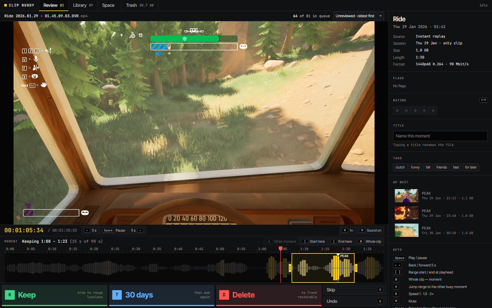
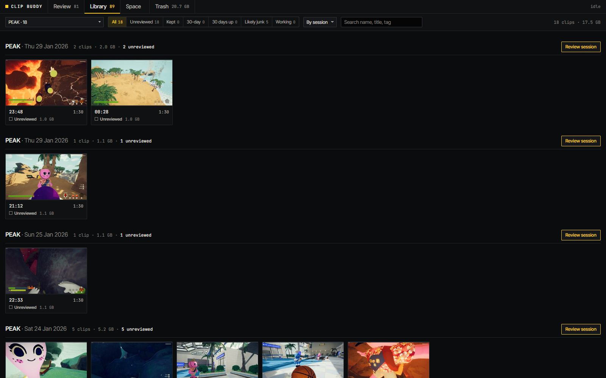
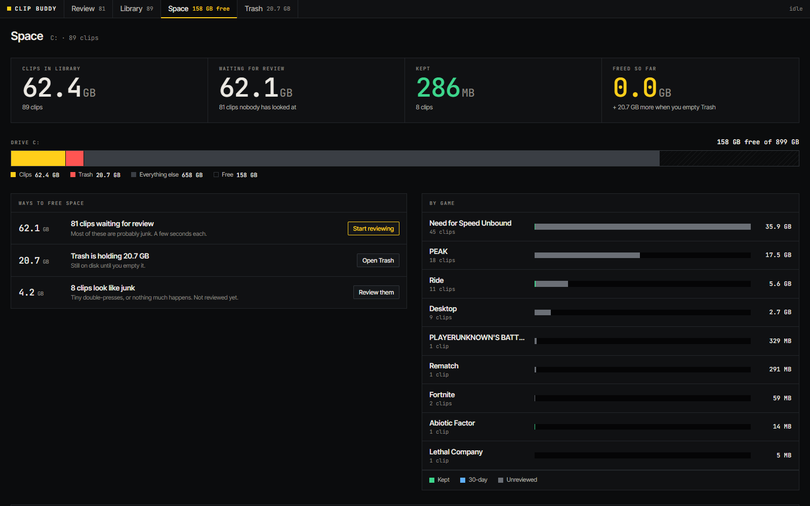

# Clip Buddy

**Stop drowning in 1 GB game clips.** Clip Buddy finds the moment each NVIDIA Instant Replay clip was saved for, lets you keep or delete it in a few seconds from the keyboard, trims what you keep to the moment without quality loss, and compresses it about 4.5× smaller.

[](https://github.com/SneakyMuffins/clip-buddy/actions/workflows/ci.yml)


[](LICENSE)



A 90-second 1440p60 replay is about 1 GB, and you probably wanted 15 seconds of it. Clip Buddy turns that into a ~40 MB file with the moment in it, and gets you through a backlog of a hundred clips in one sitting.

Everything runs locally. Nothing is uploaded, and nothing is deleted until you empty the Trash.

## Features

- **Finds the moment.** Audio loudness, voice and on-screen motion, weighted toward the end of the clip, because Instant Replay saves what happened *before* you pressed the hotkey. Shown as a waveform with the suggested range already set.
- **Keyboard triage.** `K` keep, `T` keep for 30 days, `D` delete, `U` undo. Each clip starts playing just before its moment.
- **Lossless trim.** Kept clips are cut to the range without re-encoding.
- **Compression with a quality check.** HEVC on your GPU (NVIDIA, AMD or Intel) or the CPU. Every file is checked with VMAF and must score 95+ before it replaces the original.
- **Back-to-back saves.** Pressed the hotkey twice? The pieces are detected and joined into one clip.
- **Junk detection.** Flags double-press clips and clips where nothing happens, with a one-click queue to clear them.
- **Sessions.** Clips are grouped by game and evening, so you can review a whole night at once.
- **"Keep for 30 days".** For clips that only matter for a while: they come back for a decision when the time's up.
- **Safe by design.** Every decision can be undone, replaced originals go to a restorable Trash, and new files are checked before old ones move.

<table>
<tr>
<td></td>
<td></td>
</tr>
<tr>
<td align="center">Library: grouped by session, hover to scrub</td>
<td align="center">Space: where your disk went and how to get it back</td>
</tr>
</table>

## Install

### Windows download (recommended)

1. Download **`ClipBuddy-<version>-windows.zip`** from the [latest release](https://github.com/SneakyMuffins/clip-buddy/releases/latest).
2. Unzip it somewhere permanent, for example `Documents\Clip Buddy`.
3. Double-click **`ClipBuddy.exe`**.

Nothing else to install: ffmpeg is included. Clip Buddy opens in your browser and asks where your clips are. NVIDIA's default folder, `Videos\NVIDIA`, is detected automatically.

Windows may show "Windows protected your PC" the first time, because the exe is not code-signed: click **More info**, then **Run anyway**.

**To update:** close Clip Buddy, then unzip the new version over the old folder. If you unzip it somewhere new instead, copy the `data` folder and `config.json` from the old folder into the new one before starting it: they hold your decisions. Your clips themselves stay where they are either way.

### From source with `ClipBuddy.bat`

1. **Code → Download ZIP** on this page, and unzip it anywhere.
2. Double-click **`ClipBuddy.bat`**.

The first start installs anything missing (Python, ffmpeg) with `winget`, then asks you to run it again. After that it opens Clip Buddy in your browser.

### With pip

Requires Python 3.10+ and [ffmpeg](https://ffmpeg.org/download.html) on your `PATH` (with libvmaf, which most full builds include).

```bash
pip install git+https://github.com/SneakyMuffins/clip-buddy.git
clipbuddy
```

## Usage

The first run analyzes your library in the background, a few seconds per clip. The top bar shows how far along it is and roughly how long is left. You can start reviewing right away: the clip you're looking at is always analyzed first.

**Analysis runs in the Clip Buddy console window, not in the browser.** Close or reload the browser tab whenever you like; reopen `http://localhost:8765` to come back. Keep the console window open (minimized is fine) while it works. If you close it, nothing is lost: finished clips stay analyzed, and it continues where it stopped next time. New clips appear automatically while it runs.

| Key | Action |
|---|---|
| `K` | Keep: move to Keepers, trim to the yellow range, compress |
| `T` | Keep for 30 days, then ask again |
| `D` | Delete (to Clip Buddy's Trash, restorable) |
| `S` / `U` | Skip / Undo (decisions wait 8 s before touching the file) |
| `W` | Whole clip ↔ suggested moment |
| `A` | Jump the range to the other busy moment (hollow marker) |
| `[` `]` | Set range start / end at the playhead, or drag the handles |
| `Space`, `←` `→` | Play/pause, ±5 s |
| `R`, `M`, `1`–`5` | Speed, mute, rating |

Kept clips and the Trash live in a **`Clip Buddy Library`** folder next to your clips folder. Change the clips folder any time from the **Space** tab.

## Configuration

Your choices are saved in `config.json` next to the app. Optional keys:

| Key | Default | Meaning |
|---|---|---|
| `compress_keepers` | `true` | Compress kept clips |
| `cq` | `28` | Compression strength: 28 ≈ 4.5× smaller, 24 ≈ 3× smaller at slightly higher quality |
| `encoder` | `"auto"` | `nvenc`, `amf`, `qsv` or `x265` to force one |
| `vmaf_min` | `95` | Minimum quality for a compressed file to replace the original |
| `temp_days` | `30` | How long "keep for 30 days" lasts |
| `grace_seconds` | `8` | Undo window before a decision touches the file |
| `analysis_workers` | `"auto"` | Clips analyzed at once. Auto: one per 4 CPU threads, at most 4 |
| `port` | `8765` | Local port of the web UI |

## FAQ

**Does it upload anything?** No. It's a local web app bound to `127.0.0.1`, and your clips never leave your PC.

**Can it lose my clips?** Deleted clips and replaced originals go to Clip Buddy's Trash, and only **Empty trash** (hold the button for 1.5 s) deletes them for good. Trimmed and compressed files are verified before the original moves.

**Does it work without an NVIDIA card?** Yes. Compression uses AMD or Intel hardware encoders when available, and the CPU otherwise. With the Windows download, NVIDIA's encoder needs driver 570 or newer. CPU encoding is slower (minutes per clip) at the same quality. The Space tab shows which encoder is in use.

**Other recorders (AMD ReLive, OBS, Xbox Game Bar, Steam, Medal)?** Yes. Any folder of `.mp4`, `.mkv` or `.mov` files works. The game, the time and whether a file is a replay are read from any name style (see [how it works](docs/how-it-works.md#reading-any-recorders-files)), and setup suggests the usual folders of each recorder.

**macOS / Linux?** The Python app is cross-platform, but only Windows is tested so far. Use the pip install.

Read [how it works](docs/how-it-works.md) for the details: the moment scoring, the compression measurements and the safety rules.

## Development

```bash
git clone https://github.com/SneakyMuffins/clip-buddy.git
cd clip-buddy
python -m venv .venv
.venv\Scripts\pip install -e .[dev]
.venv\Scripts\python -m clipbuddy
```

```bash
.venv\Scripts\python -m pytest
```

The test builds a temporary library from generated clips and runs the full flow (detect, keep, trim, compress, undo, delete, restore, join, empty Trash). Set `CLIPBUDDY_TEST_ENCODER=x265` to test the CPU encoder. See [CONTRIBUTING.md](CONTRIBUTING.md).

## License

[MIT](LICENSE)
